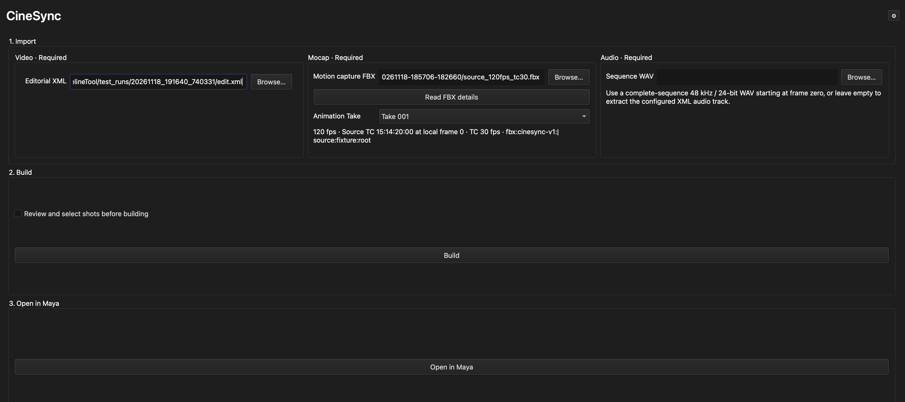

# CineSync Player

Package edited multi-camera reference footage and review it in a floating player synchronized with Autodesk Maya's timeline.

The desktop workflow pairs Premiere XML with a solved skeleton FBX Take using
embedded shoot timecode. Build generates shot FBX files starting at Maya 1001.
The current reader uses CineSync's custom v1 FBX metadata format. Developers
integrating a capture tool that exports a different format need an adapter.
See the [adapter guide](docs/MOCAP.md#add-a-mocap-software-adapter) and
[FBX setup instructions](docs/MOCAP.md).

## Use the macOS app

Open `CineSync Bridge.app` and complete the one-time Maya setup. Import the
Premiere XML and motion capture FBX (and audio if required), click **Build**, then **Open in Maya**.
The [desktop guide](docs/DESKTOP.md) covers setup, FFmpeg and audio options.



## Work from source

To build the macOS preview locally, run `scripts/build_macos.command`. The
bundle is written to `dist/CineSync Bridge.app`. For code changes and tests,
see [Contributing](CONTRIBUTING.md).

## Repository layout

```text
cinesync/
  app/               Standalone macOS GUI
  config/            Packaged defaults, schema, profile loading
  core/              Timecode, validation, local bridge
  adapters/          Maya receiver, ingest, and FBX worker
  pipeline/          XML preparation, FFmpeg jobs, cancellation
  player/            Maya floating player and Qt compatibility
scripts/             Desktop build tooling
tests/               Unit tests and manual synthetic-media tools
examples/            Portable configuration examples
docs/                User and development guides
```

## Configuration

Production FPS comes from the editorial sequence and is passed through the export configuration to the manifest. Maya reads that value. Fractional/VFR inputs must be conformed explicitly before packaging.

Manifest v1 requires each shot to start at Maya frame 1001. Packaged defaults and schema live in `cinesync/config/`. Profiles are saved in the user application-data directory. Image resolution is set in the GUI or with `--height`; cache and prefetch use `PlayerSettings`. Synthetic test FPS is independent and stored in `tests/manual/config.json`.

## CLI quick start

From the repository root, with Python 3.9+, FFmpeg, and ffprobe available:

```sh
python -m cinesync.pipeline.premiere_xml edit.xml examples/project_config.json export_config.json
python -m cinesync.pipeline.export_prep export_config.json packages/SEQ01 --height 720
```

Customize the project configuration first. It defines camera roles and shot detection. `examples/recipe.json` demonstrates direct exporter input; the generated `manifest.json` describes the output package consumed by Maya.

In Maya's Python Script Editor:

```python
import sys
sys.path.insert(0, r"/path/to/CutScenePipelineTool")
from cinesync.adapters.maya.launcher import show_launcher
show_launcher()
```

Select a package and shot, then click **Open and set up Maya shot**. For direct API use:

```python
from cinesync.player import ui
from cinesync.config.settings import PlayerSettings
player = ui.show('/path/to/package/manifest.json', 'SH010',
                 settings=PlayerSettings(cache_megabytes=512, prefetch_frames=20))
```

The direct player API requires clicking **Set up Maya shot** or preparing the scene yourself.

## Further reading

- [Editorial and Maya workflow](docs/WORKFLOW.md)
- [Architecture and limitations](docs/ARCHITECTURE.md)
- [Manual test guide](docs/START_HERE.md)

Licensed under the [MIT License](LICENSE).
